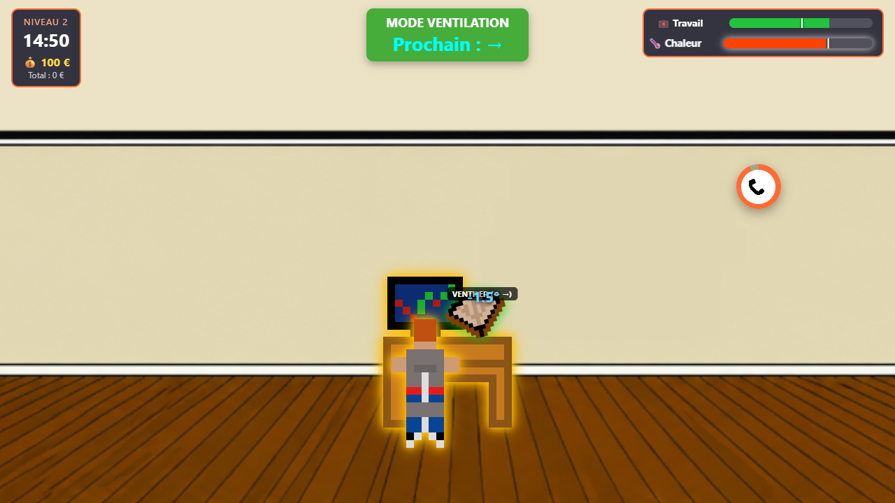

# 🌡️ Heatwave

Petit jeu web de gestion en temps réel : survivez à une journée de bureau pendant la canicule en jonglant entre **productivité** et **coups de chaud**.

**[▶ Jouer sur itch.io](https://devfch.itch.io/heatwave)**



## Le jeu

Chaque niveau est une journée de travail. Deux jauges évoluent en permanence :

- 💼 **Travail** : baisse toute seule. À 0, vous êtes renvoyé. Sous 50 %, votre salaire du jour diminue.
- 🌡️ **Chaleur** : monte toute la journée, encore plus vite l'après-midi. Au-delà du seuil, c'est la surchauffe et le travail rapporte moitié moins. À 100 %, c'est perdu.

Tenez jusqu'à 18h pour toucher votre salaire, puis dépensez-le dans la **boutique** entre deux niveaux : ventilateur, abonnement IA, plante verte… De nouveaux objets se débloquent quand vous découvrez de nouvelles difficultés. Au niveau 2, des appels urgents apparaissent : répondez avant qu'ils n'éclatent. Le patron vous confie aussi le travail du **gratte-papier** : des phrases à recopier avant l'heure limite, chacune rapportant du travail.

Au niveau 3, une troisième jauge apparaît : 😊 **l'humeur du patron**. Il vous envoie des messages dans la journée, auxquels il faut répondre en choisissant une des trois réponses proposées (sans réponse, il s'agace). Il organise aussi des **visios** : s'éventer caméra allumée l'agace. À 0, vous êtes licencié.

Au niveau 4, le réseau électrique sature : à chaque **coupure de courant**, l'ordinateur s'éteint et le travail ne monte plus. Il faut ouvrir le disjoncteur et taper la combinaison de flèches affichée pour relancer le courant, pendant que le patron continue d'écrire.

Au niveau 5, dernier jour de la canicule, plusieurs difficultés se cumulent : appels urgents, messages du patron, deux visios, et à 14h trois courtes notes de service à recopier avant 17h.

À la fin du dernier jour, la canicule se termine sur l'une des **fins** de l'histoire. Certains objets de la boutique n'ont aucun effet de jeu mais débloquent d'autres fins, à choisir parmi celles obtenues.

### Commandes

| Action | Commande |
| --- | --- |
| Passer en mode travail | Clic sur le personnage, le bureau ou l'ordinateur |
| Travailler | `Espace` |
| Passer en mode ventilation | Clic sur l'éventail |
| Se ventiler | Alterner `←` et `→` |
| Répondre à un appel | Clic sur le téléphone |
| Ouvrir / fermer la fiche RH | Bouton « 📋 Fiche RH » en bas à gauche |
| Ouvrir / fermer la recopie | Bouton « 📝 Recopie » en bas à droite |
| Répondre au patron | Clic sur une des réponses de son message |
| Relancer le courant | Clic sur le disjoncteur, puis taper la combinaison de flèches |
| Pause | `Échap` |

Un code bien connu, tapé sur le menu de démarrage ou de pause, permet de choisir son niveau…

Le premier niveau commence par un appel du patron et un tutoriel interactif. Pendant la journée, il faut aussi remplir et signer la **fiche RH** du nouvel employé avant 16h, sinon c'est le game over.

## Points techniques

- **JavaScript vanilla, modules ES, aucune dépendance** : pas de framework ni de bundler, le navigateur charge directement les sources.
- **Règles du jeu isolées et testées** : toute la logique (chaleur, surchauffe, alternance des flèches, salaire, fin de partie, comparaison de la recopie sans tenir compte des accents ni de la ponctuation) est faite de fonctions pures dans [`src/core/rules.js`](src/core/rules.js), sans accès au DOM ni à l'état global. Elles sont couvertes par des tests unitaires avec le test runner natif de Node (`node:test`).
- **État centralisé** : un seul objet [`state`](src/core/state.js) avec une phase explicite (`menu` → `dialogue` → `tutorial` → `playing` → `ended`) et un indicateur de pause indépendant.
- **Découplage par événements** : un [bus d'événements](src/core/events.js) minimal permet au tutoriel et aux visios de réagir aux actions du joueur sans que le code des contrôles les connaisse.
- **Boutique pilotée par la configuration** : chaque objet décrit ses effets sur les paramètres du niveau (`multiply`, `add`) dans [`src/config/shop.js`](src/config/shop.js). Une fonction pure applique ces effets à une copie du niveau, sans toucher au code des systèmes de jeu. Un objet qui améliore une fonctionnalité (`requires`, ex : les appels urgents) n'est proposé qu'après un niveau où le joueur l'a rencontrée.
- **Niveaux pilotés par la configuration** : durée de la journée, vitesses, seuils, salaire, appel d'introduction, appels pendant la journée, humeur du patron, visios, coupures de courant et tâches à rendre avant une heure limite (fiche RH, gratte-papier) sont réglés dans [`src/config/levels.js`](src/config/levels.js) (documenté en JSDoc).
- **Traductions** : tous les textes du jeu (dialogues de l'histoire, phrases à recopier, noms des niveaux, tutoriel, textes de l'interface via les attributs `data-i18n`) sont dans un fichier par langue ([`src/i18n/locales`](src/i18n/locales)), avec repli sur le français. Un test vérifie que chaque langue contient tous les textes. La langue se choisit avec `?lang=en` dans l'URL.
- **CI/CD** : à chaque push sur `main`, GitHub Actions lance les tests, puis publie le jeu sur itch.io avec [butler](https://itch.io/docs/butler/).
- **Rendu** : scène en 16:9 qui couvre tout l'écran, sprites en pixel art, animations et retours visuels en CSS.

## Structure

```
index.html              Structure de la page : HUD, scène, écrans
src/
├── main.js             Point d'entrée : branche les boutons et les contrôles
├── input.js            Clavier et clics sur la scène
├── config/
│   ├── levels.js       Paramètres de chaque niveau
│   ├── shop.js         Objets de la boutique et leurs effets
│   └── endings.js      Fins de la partie et leurs conditions
├── core/
│   ├── state.js        État de la partie
│   ├── rules.js        Règles du jeu (fonctions pures, testées)
│   ├── game.js         Boucle de jeu, début et fin de journée, pause
│   ├── employee.js     Validation de la fiche employé (fonction pure, testée)
│   ├── upgrades.js     Effets des objets achetés (fonctions pures, testées)
│   ├── endings.js      Fins débloquées (fonction pure, testée)
│   ├── sequence.js     Détection d'un code secret au clavier (testée)
│   └── events.js       Bus d'événements
├── i18n/
│   ├── index.js        Choix de la langue, accès aux textes
│   └── locales/        Textes par langue (fr, en) : interface, dialogues, phrases à recopier, messages du patron
├── systems/
│   ├── dialogue.js     Appels téléphoniques de l'histoire
│   ├── employeeForm.js Fiche du nouvel employé
│   ├── copyTask.js     Gratte-papier : phrases à recopier
│   ├── shop.js         Boutique entre deux niveaux
│   ├── endings.js      Choix et récit des fins après le dernier niveau
│   ├── levelSelect.js  Easter egg : choix du niveau par code secret
│   ├── tutorial.js     Tutoriel guidé
│   ├── bubbles.js      Appels urgents
│   ├── bossMood.js     Humeur et messages du patron
│   ├── meetings.js     Visios
│   ├── outages.js      Coupures de courant
│   └── money.js        Salaire
├── ui/
│   ├── hud.js          Horloge, jauges, salaire, mode actif
│   ├── screens.js      Menus et écrans de fin
│   └── effects.js      Animations et textes flottants
├── styles/             Feuilles de style par zone de l'interface
└── images/             Sprites
tests/
├── rules.test.js       Tests unitaires des règles
├── employee.test.js    Validation de la fiche employé
├── upgrades.test.js    Effets et achat des objets de la boutique
├── endings.test.js     Conditions des fins et fins atteignables
├── sequence.test.js    Détection du code secret
└── i18n.test.js        Complétude des traductions
```

## Lancer le projet

Les modules ES doivent être servis en HTTP : ouvrir `index.html` directement ne fonctionne pas.

```bash
npm start   # serveur local sur http://localhost:3000
npm test    # tests unitaires (Node 20+)
```

L'extension **Live Server** de VS Code fonctionne aussi.

## Ajouter un niveau

Copier un bloc dans [`src/config/levels.js`](src/config/levels.js), lui donner un nouvel `id` et ajuster ses valeurs. Mettre `bubbles: null` pour désactiver les appels urgents. Le nom et la description du niveau vont dans `levels.<id>` de chaque fichier de [`src/i18n/locales`](src/i18n/locales).

Pour un appel du patron pendant la journée, ajouter une entrée dans `calls`, avec éventuellement des phrases à recopier données à la fin de l'appel :

```js
calls: [{ hour: 13, dialogue: 'lunch', copyTask: { count: 5, deadlineHour: 17, reward: 15 } }]
```

Le dialogue (`lunch`) se trouve dans `dialogues` de chaque fichier de [`src/i18n/locales`](src/i18n/locales), et les phrases dans `copyTexts`.
